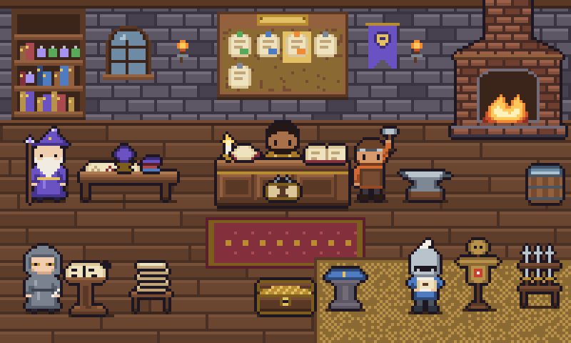
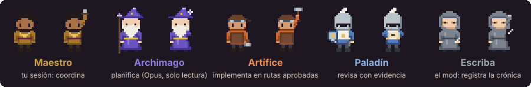
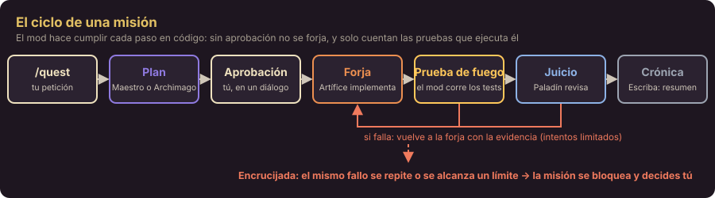
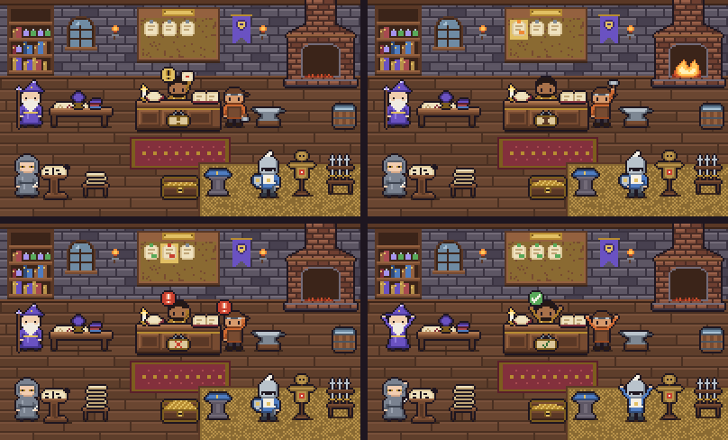

<p align="center"></p>

<h1 align="center">GuildFlow</h1>

<p align="center"><strong>Un gremio de agentes para Claude Code.</strong> Lleva un encargo de programación de principio a fin: plan con criterios verificables, tu aprobación, implementación limitada a rutas concretas, pruebas ejecutadas por el propio sistema, revisión independiente y límites duros de coste, tiempo e intentos.</p>

<p align="center">Plugin para Claude Code ≥ 2.1.295 (Desktop y CLI) · Interfaz en español · Licencia MIT</p>

> **English summary.** GuildFlow is a Claude Code plugin (a *mod*) that turns a request into a supervised "quest": a planner writes a plan with verifiable acceptance criteria, you approve it, an implementer works only inside the approved paths, the mod itself runs the tests, a read-only reviewer judges each criterion with evidence, and hard limits (tokens, cost, time, attempts) stop runaway loops. A pixel-art office in the side pane shows what every agent is actually doing. The UI and docs are in Spanish.

---

## Qué resuelve

Pedir a un agente "arregla esto" funciona hasta que deja de funcionar. Puede declarar éxito sin pruebas, tocar archivos que no debía, reintentar sin fin o gastar más de lo previsto. GuildFlow pone un **protocolo en código** alrededor del trabajo:

- **Nada se implementa sin un plan aprobado.** El plan fija las subtareas, las rutas que cada una puede escribir, las comprobaciones con su comando exacto y los criterios de aceptación.
- **Las afirmaciones de un agente no cuentan como evidencia.** Los tests los ejecuta el mod, y la revisión la hace otro agente, de solo lectura.
- **Los límites no se pueden desactivar:** intentos por subtarea, iteraciones, agentes, tokens, coste equivalente, uso de la suscripción, tiempo, archivos y líneas de diff.
- **Si el mismo fallo se repite**, la misión se bloquea y te pregunta, en lugar de insistir.

## El gremio

<p align="center"></p>

| Rol | Quién es | Qué puede hacer |
|---|---|---|
| **Maestro** | Tu sesión de Claude Code | Coordina: planifica los cambios pequeños, lanza agentes y pide verificaciones. Mientras trabaja, el mod le impone el modelo (Sonnet por defecto) y el esfuerzo |
| **Archimago** | Subagente Opus | Traza el plan de las misiones con más de una subtarea. Solo lectura |
| **Artífice** | Subagente Sonnet (Opus si el plan lo pide para trabajo visual o creativo) | Implementa **una** subtarea, solo dentro de sus rutas. Sin shell: comprueba su trabajo con `run_check` |
| **Paladín** | Subagente Sonnet | Revisa con independencia y emite un veredicto por criterio, con evidencia (`archivo:línea` o `runId`). Solo lectura |
| **Escriba** | El propio mod | Registra la bitácora y escribe la crónica final. Sin modelo, salvo que actives `escriba: haiku` |

## Cómo funciona

<p align="center"></p>

1. **`/quest <petición>`** abre una misión. Arranca el Maestro, que planifica él mismo si el cambio es acotado o encarga el plan al Archimago.
2. **Aprobación.** Aparece un diálogo con el plan **completo**: todas las rutas y todos los comandos, sin recortes. Solo vale ese diálogo, no un "sí" en el chat. Con `autoApprovePlan`, se aprueban solos los planes que no tocan nada sensible.
3. **Forja.** El Artífice implementa la subtarea. Cada escritura fuera de sus rutas se rechaza.
4. **Prueba de fuego.** El mod ejecuta las comprobaciones declaradas, con el comando exacto, sin shell y, opcionalmente, en Docker sin red.
5. **Juicio.** El Paladín revisa los criterios de revisión y los visuales. Para los visuales mira el resultado en el navegador local.
6. **Corrección acotada.** Si algo falla, el Artífice vuelve con la evidencia; si el mismo fallo se repite, la misión se bloquea y decides tú.
7. **Crónica.** Al terminar queda escrito `.guildflow/summary-<id>.md` con los criterios, la evidencia, los archivos y el consumo.

## La oficina del gremio

El panel lateral **«Gremio · GuildFlow»** muestra una oficina pixel art donde cada personaje refleja lo que hace **de verdad** su rol:

<p align="center"></p>

<p align="center"><sub>Arriba: esperando tu aprobación · el Artífice implementando. Abajo: misión bloqueada · misión completada.</sub></p>

- Un personaje solo trabaja si su agente figura **en curso** en el registro del mod. Si la misión está en pausa, detenida o bloqueada, nadie trabaja. Un agente perdido tras un reinicio se ve en gris con «?».
- El **tablón de encargos** tiene una nota por subtarea, con el color de su estado; la activa lleva marco dorado.
- La **placa del mostrador** resume el estado global: en curso, esperando tu aprobación, bloqueada, en pausa, detenida o cumplida.
- El **cofre** se llena según el consumo real del presupuesto; la **pila de hojas** junto al Escriba crece con la bitácora.
- La fragua solo arde cuando el Artífice trabaja, y la esfera del Archimago solo brilla cuando él piensa.

Debajo de la escena, el panel muestra:

- la cabecera, con el **estado real** (`Estado real: IMPLEMENTING · Subtarea: t2 · Intento: 1/3`);
- quién hace qué, en texto;
- los botones **Detener**, **Reanudar** o **Revisar el plan**, **Estado completo** y **Animación**;
- el progreso por subtareas y criterios;
- los encargos, con el veredicto de cada criterio;
- el **tesoro**: tokens, coste *equivalente* de API (no lo facturado), uso de la suscripción, tiempo, agentes, archivos y diff;
- la bitácora.

La animación es discreta (dos fotogramas, solo en lo que trabaja) y se puede desactivar. En la terminal, el panel es de texto, con la misma información y los mismos controles. Detalles de diseño: [`docs/12-pixel-art-board.md`](docs/12-pixel-art-board.md).

## Instalación

**Requisitos**

- **Claude Code 2.1.295 o posterior**, Desktop o CLI. La API de mods está en acceso anticipado y puede cambiar entre versiones.
- El proyecto donde lo uses debe ser un **repositorio git**: `diff-scope` compara contra el `HEAD` aprobado.
- Los ejecutables que usen tus comprobaciones. Por defecto se admiten `node`, `git`, `tsc`, `python`, `py`, `pytest`, `cargo`, `go`, `dotnet`, `deno` y `bun`.
- Opcional: **Docker**, para aislar las comprobaciones (`sandbox: docker`).

**Desde el marketplace (recomendado).** En una sesión de Claude Code en terminal:

```
/plugin install guildflow --marketplace capibara-html/GuildFlow
```

Responde `y` para añadir el marketplace, elige el ámbito y ajusta las opciones. Después puedes cambiarlas con `/plugin configure guildflow@guildflow`. También desde la línea de comandos:

```bash
claude plugin marketplace add capibara-html/GuildFlow
```

```bash
claude plugin install guildflow@guildflow
```

**Desde una copia local.**

```bash
git clone https://github.com/capibara-html/GuildFlow.git
```

```bash
claude plugin marketplace add ./GuildFlow
```

```bash
claude plugin install guildflow@guildflow
```

En cada proyecto donde lo uses, añade `.guildflow/` al `.gitignore`: ahí se guardan el estado, la bitácora y la evidencia. Para comprobar que está cargado, escribe `/quest-status` en una sesión nueva. Debe responder «Sin misión…».

## Primera misión

```
/quest Corrige la función sum de src/math.js para que devuelva a+b. Comprobación: node --test test/math.test.js (mínimo 1 test).
```

1. Abre el panel con `/quest-status` y deja que el Maestro prepare el plan.
2. Lee el diálogo de aprobación y pulsa **«Sellar el pergamino»** para aprobar, o rechaza el plan con un motivo.
3. Mira la oficina: el Artífice forja, el mod pasa los tests y el Paladín juzga.
4. Lee la crónica en `.guildflow/summary-<id>.md`.

Si la petición no trae tests que la verifiquen, la primera subtarea del plan los escribe y quedan congelados: el Artífice no puede tocarlos después.

## Comandos

| Comando | Qué hace |
|---|---|
| `/quest <petición>` | Abre una misión. Si la anterior estaba detenida, bloqueada o en pausa, la archiva |
| `/quest-status` | Estado completo (criterios, agentes, consumo, siguiente paso) y abre el panel |
| `/quest-halt` | Detiene la misión ya, conservando el trabajo |
| `/quest-resume` | Reanuda tras confirmar. Si estaba bloqueada, concede un intento más; si espera aprobación, vuelve a abrir el diálogo |

## Configuración

Las opciones se ajustan al instalar, con `/plugin configure guildflow@guildflow`, o en `~/.claude/settings.json`:

```json
{ "pluginConfigs": { "guildflow": { "options": { "autoApprovePlan": true, "tokenBudgetPerQuest": 1000000, "theme": "gremio" } } } }
```

| Opción | Por defecto | Para qué |
|---|---|---|
| `autoApprovePlan` | `false` | Aprueba sin diálogo los planes no sensibles: nada de dependencias, CI, secretos, configuración ni instrucciones de agentes |
| `tokenBudgetPerQuest` · `costBudgetUsd` · `wallClockMinutes` | 2M · 25 · 60 | Presupuesto de cada misión. El USD es el equivalente a precio de API |
| `maxAttemptsPerTask` · `maxQuestIterations` | 3 · 8 | Intentos y vueltas antes de bloquear |
| `maxParallelArtifices` | 1 | Hasta 3 Artífices a la vez en talleres separados |
| `sandbox` | `none` | `docker`: cada comprobación corre en un contenedor sin red y con el proyecto de solo lectura |
| `theme` | `gremio` | `sobrio` quita la ambientación y deja solo el dato |
| `escriba` | `none` | `haiku`: un resumen en lenguaje llano al principio de la crónica |

La tabla completa, con topes y matices, está en [`guildflow/README.md`](guildflow/README.md#configuración). Los valores fuera de rango se acotan a los topes, así que ningún límite se puede desactivar.

## Seguridad

> **Aviso.** Un plugin de Claude Code se ejecuta **sin sandbox y con tus permisos**. Las comprobaciones ejecutan el código que escribe el Artífice. Úsalo en repositorios de confianza o activa `sandbox: docker`.

Lo que el mod impone en código:

- rutas por subtarea y rutas protegidas (los tests que definen la evaluación);
- comandos exactos, sin shell, con una lista de ejecutables permitidos;
- navegador limitado a la máquina local;
- aprobación solo por diálogo;
- detención por seguridad si `quest.json` se modifica desde fuera;
- tachado de secretos conocidos en la evidencia.

Mientras la misión trabaja, las acciones sensibles del Maestro (push, despliegue, instalaciones, borrados, escrituras fuera del repositorio) te piden confirmación. Revisión completa: [`docs/09-security-review.md`](docs/09-security-review.md).

## Documentación

| Documento | Contenido |
|---|---|
| [`docs/guia-guildflow.html`](docs/guia-guildflow.html) | **Guía de uso completa**: instalación, comandos, configuración, seguridad, limitaciones por tipo de proyecto, solución de problemas y glosario. Descárgala y ábrela en el navegador |
| [`guildflow/README.md`](guildflow/README.md) | Referencia del plugin: opciones, uso, glosario, desarrollo |
| [`docs/01`](docs/01-repository-audit.md) – [`docs/04`](docs/04-autonomy-and-safety.md) | Auditoría de referentes, decisión de arquitectura, matriz de roles, autonomía y seguridad |
| [`docs/05-mvp-roadmap.md`](docs/05-mvp-roadmap.md) | Hoja de ruta por fases |
| [`docs/06`](docs/06-poc-results.md) · [`docs/07`](docs/07-poc-limitations.md) | Pruebas de concepto sobre la API de mods y sus límites |
| [`docs/08-guildflow-implementation.md`](docs/08-guildflow-implementation.md) | Diseño de la implementación: máquina de estados, política y verificación |
| [`docs/09-security-review.md`](docs/09-security-review.md) | Revisión de seguridad |
| [`docs/10-test-results.md`](docs/10-test-results.md) | Resultados de las pruebas automáticas y en vivo |
| [`docs/11-analisis-mejoras.md`](docs/11-analisis-mejoras.md) | Análisis tras una misión real (Pixel Chess) |
| [`docs/12-pixel-art-board.md`](docs/12-pixel-art-board.md) | La oficina pixel art: dirección artística, paleta, poses, canalización y mapeo de estados |

## Estructura del repositorio

```
GuildFlow/
├── .claude-plugin/marketplace.json   marketplace de un solo plugin
├── guildflow/                        el plugin
│   ├── hooks/register.tsx            módulo de hooks: conecta los eventos del motor con todo lo demás
│   ├── src/machine.ts                máquina de estados de la misión (pura)
│   ├── src/policy.ts                 qué herramienta puede usar cada rol y cuándo
│   ├── src/validation.ts             validación del plan y de los límites
│   ├── src/verification.ts           ejecución de comprobaciones y diff-scope
│   ├── src/persistence.ts            .guildflow/: estado, bitácora y evidencia
│   ├── src/presentation.tsx          textos, panel y mapeo de estado a pose
│   ├── src/art.ts · src/sprites.ts   arte de la oficina (mapas de píxeles) y compositor SVG
│   ├── agents/ · skills/             Archimago, Artífice, Paladín; /quest, /quest-resume y el protocolo del Maestro
│   ├── scripts/art.mjs               vistas previas, capturas e ilustraciones del arte
│   ├── art/                          hoja de personajes, capturas y paleta de Aseprite
│   └── tests/                        pruebas con el kit del motor (claude plugin test)
├── docs/                             diseño, pruebas, guía e ilustraciones
├── poc/                              pruebas de concepto de la API de mods
└── bench/                            banco para comparar misiones
```

## Desarrollo

Para trabajar en el plugin, cárgalo desde la carpeta con `CLAUDE_CODE_PLUGIN_DIRS` en el bloque `env` de `~/.claude/settings.json` (ruta absoluta), o para una sola sesión de CLI:

```bash
claude --plugin-dir ./guildflow
```

Validar y pasar las pruebas. Ejecutan el plugin dentro del motor real del kit de pruebas:

```bash
claude plugin validate guildflow
```

```bash
claude plugin test guildflow
```

Regenerar las vistas previas, las capturas, la hoja de personajes y las ilustraciones del arte (Node ≥ 22.6):

```bash
node guildflow/scripts/art.mjs
```

En Windows, si el CLI de terminal es anterior a 2.1.295, sirve el binario que trae Desktop: `%APPDATA%\Claude\claude-code\<versión>\<hash>\claude.exe`. El arte se edita como texto en `guildflow/src/art.ts`; la canalización y la paleta para Aseprite se describen en [`docs/12`](docs/12-pixel-art-board.md#4-fuentes-y-canalización).

## Estado del proyecto

Versión **0.3.0**:

- **Fases 1 a 4 implementadas**:
  - núcleo del gremio;
  - verificación por el mod;
  - límites;
  - recuperación tras reinicio;
  - temática de rol y oficina pixel art;
  - sandbox Docker;
  - Artífices en paralelo;
  - Escriba opcional con Haiku.
- **Pruebas:** 213 automáticas en verde, más misiones reales de principio a fin; la más grande, un ajedrez pixel art de 5 subtareas y 26 criterios.

Limitaciones conocidas:

- La API de mods está en acceso anticipado.
- La interfaz está solo en español.
- El esfuerzo aplicado no se puede confirmar desde la API.
- En paralelo solo va la implementación.

Limitaciones por tipo de proyecto: [guía, §8](docs/guia-guildflow.html).

## Licencia

[MIT](LICENSE). Todo el arte (oficina, personajes e iconos) es original; ver [`guildflow/ASSETS.md`](guildflow/ASSETS.md). No incluye código ni recursos de los proyectos de referencia.
